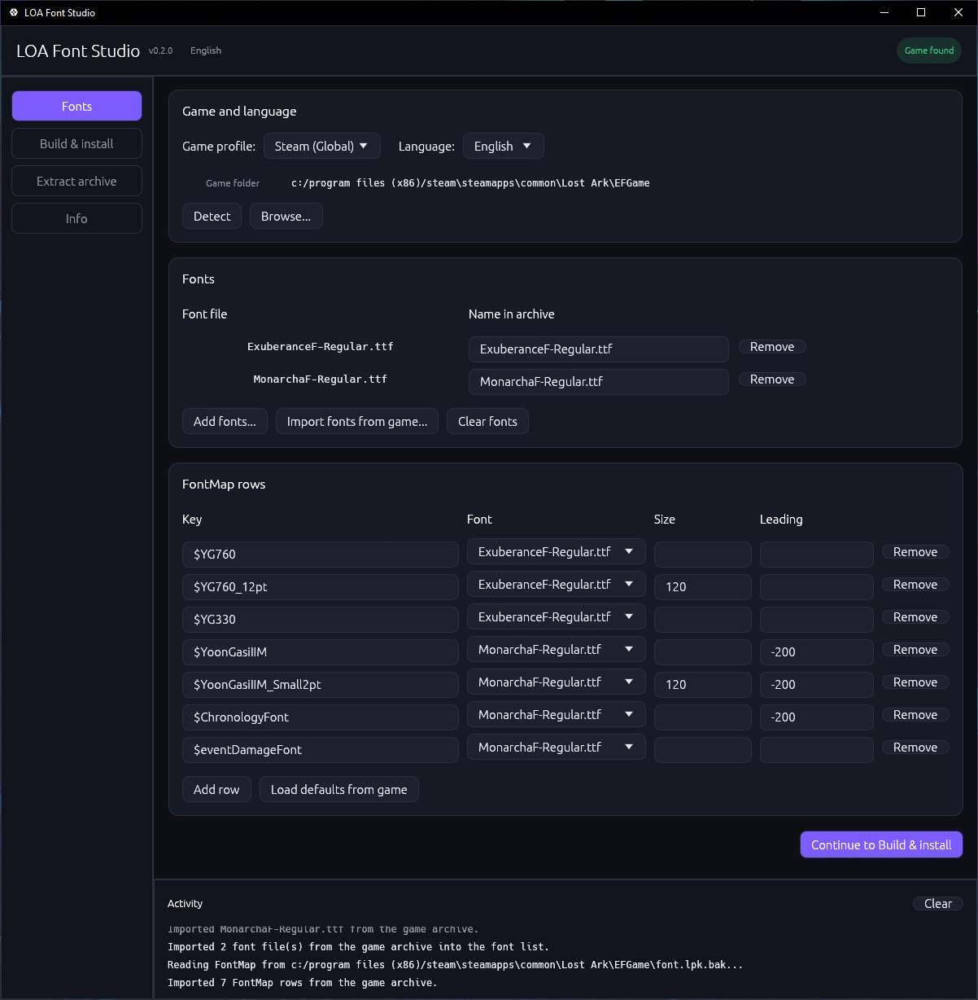

# LOA Font Studio

LOA Font Studio is a native modding tool for the `font.lpk` archive used by Lost Ark. It lets you replace the game's fonts, edit the `FontMap.xml` entries that control text styles, and build a valid archive without QuickBMS scripts or manual hex editing.

The app can also install a finished package into the game folder, keep a backup of the original file, and restore it later.

## Features

- Open, inspect, filter, and extract `font.lpk` archives.
- Add TTF fonts and choose the file name used inside the archive.
- Edit FontMap rows: key, font file, size correction, and leading correction.
- Load the original FontMap rows and language fonts directly from the game archive.
- Build a package for a specific language folder and client profile.
- Install a built package with an automatic `font.lpk.bak` backup.
- Restore the original archive from the app.
- Remember settings between launches.

Supported client profiles: Steam (Global), Russia*, Japan*, Taiwan*, Korea*, and China*.

Supported language folders: English, Spanish**, French**, German**, Russian*, Japanese**, Chinese*, Taiwanese*, and Korean*.

*: Untested, feedback needed.

**: Discontinued language folders, Steam (Global) uses English folder.

## Screenshots

### Main GUI



### In-game Showcase (FiraCode-Bold Font)


## Download & Building

**Download the latest release from the [repository's releases page](https://github.com/TanByv/loafont-rs/releases) and run the binary for your platform.**

To build from source, install the Rust toolchain (edition 2024 requires Rust 1.85 or newer), then run:

```bash
cargo build --release
```

The binary is written to:

```text
target/release/loa-font-studio
```

On Windows the file is `loa-font-studio.exe`.

Linux builds need the usual X11/Wayland development packages. On Debian or Ubuntu, for example:

```bash
sudo apt install build-essential pkg-config libx11-dev libxkbcommon-dev libwayland-dev
```

## Usage

1. Start the app and select the game profile and language.
2. If the game is installed, use Detect or Browse to select the `EFGame` folder. (Not required if you don't want to install the modded `font.lpk`)
3. Add your font files on the Fonts tab.
4. Adjust the FontMap rows to your liking.
5. Choose an output path, then use Build only or Build and install.
6. Use Restore original at any time to put `font.lpk.bak` back in place.

**Close the game before installing or restoring files!**

## Backups & Game Updates

Before the first install, the app copies the current `font.lpk` to `font.lpk.bak` in the same folder. It also records the installed archive hash in `font.lpk.modinfo.json` so it can tell whether the game is already modded.

"Build only" never modifies the game folder. If a backup is missing and the game files are in an unknown state, use "Verify integrity of game files" in Steam before installing again.

Steam might replace the modded `font.lpk` file with the original when you update the game or trigger an automatic "Verify integrity of game files" which will require you to install the modded `font.lpk` again in both cases. 

To avoid game file verification, which can take a while, use the "Restore original" functionality before updating the game and install the modded `font.lpk` again after updating your game.

## How it works

A Lost Ark `font.lpk` is an LPK archive:

- The entry table is encrypted with Blowfish in little-endian mode using a client-specific key.
- File data is usually zlib-compressed and then Blowfish-encrypted.
- Some entries use AES-256-CBC with a per-entry key derived from the file name and a client-specific base value.
- `FontMap.xml` maps game text-style keys such as `$YG760` to font files and correction values.

## Disclaimer

This is an unofficial community tool. It is not affiliated with Smilegate or Amazon Games. Modifying game files can break the game or violate its terms of service. Use it at your own risk.

## License

MIT
